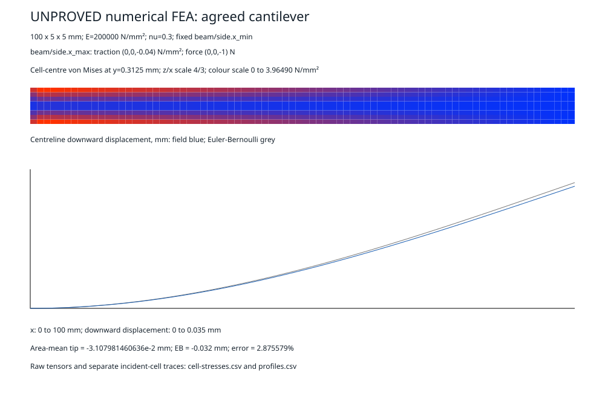

# Agreed M20 cantilever

`m20_beam` runs the first rectangular cantilever in the agreed
[FEA design](FEA-DESIGN.md). Displacement, stress, reactions and residuals are
unproved numerical estimates. Geometry certificates do not certify elasticity.
The beam, plate, sliver and imported-part acceptance lines remain separate.

## Reproduce

```sh
cargo test --release -p catallax-field --example m20_beam --example solver_beam --example beam_first_cut
cargo run --release -p catallax-field --example m20_beam -- m20-output
cargo clippy -p catallax-field --example m20_beam --example solver_beam --example beam_first_cut -- -D warnings
cargo fmt --all --check
```

Append `2`, `4` or `8` to run only that cross-section refinement.
The output directory contains one directory per grid. Each has `beam.svg`,
`profiles.csv` and `cell-stresses.csv`. The SVG shows cell-centre von Mises
stress on a declared longitudinal slice and the centreline displacement curve
beside Euler-Bernoulli. Its thickness is magnified and labelled. It does not
smooth stresses or substitute beam theory for the field solution.

## Main baseline

Main already has the full-integration Q1 solver and the frozen 100 x 10 x 10 mm
experiment. [Its recorded refinement](FEA-FIRST-CUT.md#recorded-run) reaches
0.885322% deflection error at 8 x 8 x 80 cells. The F7 adapter's published
4 x 4 x 40 result is 3.514078%. Those are different grids on the older geometry.
This change reuses that solver and adds the agreed geometry and stress recovery.
All 42 frozen F7 output rows match the reproduced main baseline exactly.

## Geometry and solver policy

The public input is [beam/agreed.json](../crates/catallax-field/examples/beam/agreed.json).
It is a single box with world bounds `[0,100] x [-2.5,2.5] x [-2.5,2.5] mm`.
The recipe independently builds a B-rep with exact volume `2500 mm³`.
M16 integration admits each assembled cell only with exact full material
fraction, a connected box and 27 exact material moments. The accumulated volume
must equal `2500 mm³`. There are no preview signs or sampled occupancy decisions.
Both representations and the picture describe this same rectangular recipe.
This run does not establish export agreement for curved or imported parts.

The fixed face is `beam/side.x_min`. The loaded face is `beam/side.x_max`.
M16 resolves both names at their world positions and checks each area is
`25 mm²`. The explicit traction is `(0,0,-0.04) N/mm²`, with resultant
`(0,0,-1) N`. Material assignment is homogeneous, with explicit
`E=200000 N/mm²` and `nu=0.3`. Other faces are traction-free.

The existing example-private solver uses local axes `(world y, world z, world x)`.
This cyclic permutation is a proper rotation. Output maps vectors, moments and
all six stress tensor components back to world axes. The fixed world x face
eliminates all displacement components. The loaded face uses consistent Q1
surface weights. Integration is full `2 x 2 x 2` Gauss integration of `Bᵀ C B`.
There is no beam element, reduced integration or fitted stiffness correction.

The frozen world grids are `[20,2,2]`, `[40,4,4]` and `[80,8,8]`.
The solver keeps its existing limits of 5120 cells, 80 cells per axis,
10000 iterations and verified relative residual at most `1e-9`.
Jacobi-preconditioned CG and its fixed assembly/reduction order are unchanged.
Each complete geometry request retains the existing 100M operation allowance.
The report separates charged geometry work, iterations, matrix entries,
matrix-vector products and their scalar products. These solver counts do not
claim to be a certified numeric operation allowance or a timing measurement.

Each grid runs complete independent requests concurrently with 1, 2 and 4
workers. Direct equality checks include every displacement unknown, recovered
stress row, reaction, residual, iteration count, solver count and charged
geometry work. The elasticity solver itself is serial. This tests concurrent
request determinism, not parallel assembly or cross-processor bit equality.

## Stress recovery and comparison

`profiles.csv` includes world x stations every `1.25 mm`, on both outer-fibre
paths `(x,0,+/-2.5)` and the centreline `(x,0,0)`. Each incident material cell
provides its own `C sym(grad(u))` tensor and full-tensor von Mises value.
At cell interfaces the CSV retains every trace; stdout gives their range at
`x=25,50,75 mm`. The corresponding outer-fibre beam references are
`3.6,2.4,1.2 N/mm²`. Centreline bending reference is zero and appears separately.
End-region traces remain in the CSV and are outside these span comparisons.
There is no separate stress-percentage acceptance claim.

The profile includes signed and absolute displacement and stress differences.
`cell-stresses.csv` contains every cell-centre tensor, without smoothing.
Tensor order is `xx,yy,zz,xy,yz,xz`, in `N/mm²`. Displacements use mm.
Expected root reaction is `(0,0,1) N`, with moment `(0,-100,0) N mm`.
Stdout includes the force and moment balance residual vectors.
An affine patch test checks stress recovery and displacement interpolation at
interior points and all incident-cell traces on internal and exterior facets.

The deflection observable is the consistently integrated area-mean tip
displacement. Its independent Euler-Bernoulli reference is `-0.032 mm`.
The comparison returns the example-private typed refusal
`fea.deflection-accuracy` whenever `abs(tip / -0.032 - 1) > 0.02`, including the
attained displacement, reference and error. A refusal preserves the numerical
field and picture, labelled unproved. It does not qualify a missed mark as a pass.

## Recorded results

The complete refinement run at `01729a5f8b1929404f91c60ab390f3e68a827a36`
produced the following unproved estimates. All complete answers, including the
retained displacement vectors and geometry work, matched exactly with 1, 2 and
4 concurrent workers at every grid. No allowance increased.

| World grid | Cells | Area-mean tip, mm | Relative deflection error | Iterations | Actual relative residual | Charged geometry work |
| --- | ---: | ---: | ---: | ---: | ---: | ---: |
| 20 x 2 x 2 | 80 | -0.022318565834910 | 30.254482% | 184 | 9.228687e-10 | 2,800 |
| 40 x 4 x 4 | 640 | -0.028790070812057 | 10.031029% | 516 | 8.491246e-10 | 22,400 |
| 80 x 8 x 8 | 5,120 | -0.031079814606362 | 2.875579% | 1,228 | 9.865516e-10 | 179,200 |

All three grids return `fea.deflection-accuracy` from the accuracy comparison.
The finest grid misses the unchanged 2% mark by 0.875579 percentage points.
It has 19,440 free unknowns, 1,338,993 stored matrix entries and 1,230 actual
matrix-vector products, including residual verification. Those products use
1,646,961,390 scalar matrix multiplications. Its maximum absolute force-balance
component is `1.483e-9 N`; the corresponding moment-balance value is
`8.744e-8 N mm`. Algebraic convergence does not establish the continuum error.

Finest-grid one-sided von Mises ranges, in N/mm²:

| x, mm | Lower outer fibre | Centreline | Upper outer fibre | Outer-fibre beam reference |
| --- | --- | --- | --- | ---: |
| 25 | [3.489097356381, 3.528290166069] | [0.512770016079, 0.686483720653] | [3.489097356274, 3.528290165961] | 3.6 |
| 50 | [2.319575574862, 2.358767673375] | [0.313255120849, 0.486840128148] | [2.319575574789, 2.358767673300] | 2.4 |
| 75 | [1.150106319224, 1.189294576759] | [0.114606428620, 0.287361972684] | [1.150106319194, 1.189294576728] | 1.2 |

The centreline bending reference is zero. These nonzero field values include
shear and discretization effects. They are reported without a stress pass claim.



The run wrote all 80, 640 and 5,120 raw cell tensors and respectively 800, 960
and 1,280 incident-cell profile traces. Independent postprocessing checked each
raw tensor's von Mises value, all declared stations and SVG parsing. The finest
SVG was rendered and inspected. Nineteen release-mode example tests passed on
the solver calculation revision `947af01b`, before output-label and balance-row
changes. Focused final Clippy with warnings denied, formatting and diff checks
pass. Full-workspace and protected-replay checks belong to hosted CI.

## Remaining M20 work

The plate with a hole, aggregate-constrained sliver solve and complete imported
solve remain open. M16's exact sliver measures do not demonstrate sliver
elasticity. The plate stress rule and imported configuration follow the
sequencing in D5 and D6. No tolerance, work limit or saved replay answer changes.
Raw evidence retained privately.
