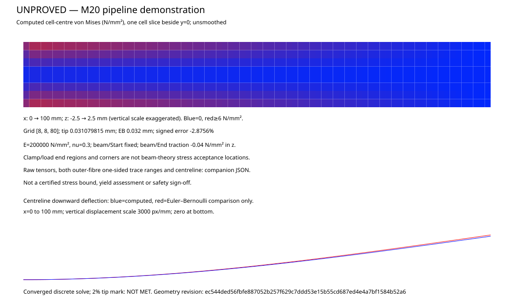

# M20 aligned field cantilever: run policy

UNPROVED numerical FEA; not suitable for safety sign-off. This bounded first
result does not complete M20's plate, sliver or imported-part exits.

Frozen baseline: cdc0a3884c59b2bea538c230e37639bd74cdb9a2.
The public recipe cyclically rotates a 5 x 5 x 100 mm native block so the
beam occupies x=[0,100], y=z=[-2.5,2.5] mm. Start/End remain the support/load
names. E=200000 N/mm², nu=0.3, traction=(0,0,-0.04) N/mm², force=-1 N.

Policy fixed before runs: Q1 displacement, eight-point Gauss volume integration,
consistent face loads, direct fixed-DOF elimination, diagonal-preconditioned CG,
recomputed residual <=1e-9, at most 10000 iterations. Retain the original solver
caps of 80 cells per axis and 5120 total. Refinement grids in internal
(y,z,x) order: [2,2,20], [4,4,40], [8,8,80]. Each run has the unchanged
100M operation allowance shared by geometry and solver. Charge one unit per
assembled cell and one per sparse matrix row evaluation; also report actual
matrix-entry products. Postprocessing reserves one unit per cell centre and
eight units per path/station (the maximum incident traces). No clock selects a numerical answer. Caller cancellation
through numeric work checks is distinct from convergence failure. Parallel row
arithmetic keeps each row's order and all reductions canonical; all available
cores by default. Geometry preparation and authoritative queries remain serial.

F7 exact cell integration must return fraction=[1,1], a connected native box
and one certain homogeneous material piece matching each cell. The conservative
closed-box state is retained, including Unknown on boundaries. F7's retained
axis-box certificate supplies coverage, never samples. Named box patches must
survive, have area 25 mm² and the prescribed centroids. Point membership and
material queries are additional checks, not coverage proofs.

Tip is the consistent area mean. Centreline and both outer-fibre traces retain
every incident cell's tensor and von Mises value; station summaries give ranges.
Cell-centre tensors are retained separately. Pictures use unsmoothed computed
cell traces, never beam-formula stresses. Stress errors are comparisons only;
there is no separate stress percentage pass. The displacement acceptance is
abs((-tip)/0.032-1)<=0.02. Clamp/load end regions and corner concentrations are
not beam-theory stress gates. SVG colours and finite trace samples are
numerical display evidence, not global stress bounds.

## Measured result: 2% mark remains open

Author execution at implementation commit `4780c92b44d99a14d5ff58b2551929e7b3c13e0b`.
The finest result is **0.031079814606362253 mm**, signed error **-2.8755793551%**.
This exceeds the unchanged 2% criterion. The recorded refinement series reaches
both inherited grid caps; its next uniform doubling would violate them.
This is a limitation of this bounded Q1 policy, not a claim that no other
approved discretization could meet the mark. No extrapolated answer is used.



[Raw finest-grid tensors, displacement DOFs and incident-cell traces](milestones/m20-cantilever/grid8.json).
[Source/executable/output identities and refinement work](milestones/m20-cantilever/manifest.json).

| Grid (y,z,x) | Cells | Tip mm | Signed relative error | Iterations | Actual residual | Logical work |
|---|---:|---:|---:|---:|---:|---:|
| [2, 2, 20] | 80 | 0.022318565835 | -30.254482% | 184 | 9.22869e-10 | 108,625 |
| [4, 4, 40] | 640 | 0.028790070812 | -10.031029% | 516 | 8.49125e-10 | 1,618,673 |
| [8, 8, 80] | 5120 | 0.031079814606 | -2.875579% | 1228 | 9.86552e-10 | 24,407,825 |

Finest-grid outer-fibre von Mises traces below envelope both z=±2.5 paths
and every incident cell at y=0; separate tensors and signed/absolute errors
are retained in the raw data. No averaging across cell boundaries occurs.

| x mm | Beam reference N/mm² | Computed trace range N/mm² | Signed error range N/mm² | Absolute error range N/mm² |
|---:|---:|---:|---:|---:|
| 25 | 3.6 | [3.489097356, 3.528290166] | [-0.110902644, -0.071709834] | [0.071709834, 0.110902644] |
| 50 | 2.4 | [2.319575575, 2.358767673] | [-0.080424425, -0.041232327] | [0.041232327, 0.080424425] |
| 75 | 1.2 | [1.150106319, 1.189294577] | [-0.049893681, -0.010705423] | [0.010705423, 0.049893681] |

| Centreline x mm | Computed downward mm | EB mm | Signed error mm | Absolute error mm |
|---:|---:|---:|---:|---:|
| 0 | -0.000000000000 | 0.000000000000 | -0.000000000000 | 0.000000000000 |
| 25 | 0.002656425091 | 0.002750000000 | -0.000093574909 | 0.000093574909 |
| 50 | 0.009695343183 | 0.010000000000 | -0.000304656817 | 0.000304656817 |
| 75 | 0.019656896161 | 0.020250000000 | -0.000593103839 | 0.000593103839 |
| 100 | 0.031079733707 | 0.032000000000 | -0.000920266293 | 0.000920266293 |

Finest force balance (reaction + load), N: `[1.4828107630648901e-09, -6.095496329905359e-11, -1.1963957602389996e-09]`.
Moment balance about the fixed-face centre/origin, N·mm: `[5.188227625296804e-11, 8.743509738451394e-08, -1.470593868901915e-09]`.
The finest run performs 1,230 matrix applications and 1,646,961,390
matrix-entry products. Logical work units are the declared row/cell costs,
not a claim that each floating operation consumes a proof unit.
All 5,120 cells have exact full-cell coverage; the classifier reports 2,808
Inside and 2,312 Unknown, the latter covered by the retained native-box certificate.

## Reproduction and qualification

```sh
cargo build -p catallax-field --example m20_cantilever --release -j 2
mkdir -p m20-output
for m in 2 4 8; do
  for workers in 1 2 4 default; do
    target/release/examples/m20_cantilever "$m" "$workers" "m20-output/grid$m-worker$workers"
  done
done
cargo test -p catallax-field --example m20_cantilever --release -j 2 -- --test-threads=1
cargo clippy -p catallax-field --example m20_cantilever --release -j 2 -- -D warnings
cargo fmt --all -- --check
git diff --check
```

All three grids were actually solved at 1/2/4/default workers (default=4
available cores here), with byte-identical complete JSON and SVG. Five focused
tests passed: affine/shear recovery and rigid translation, zero versus
underflow, uneven/overprovisioned row partitions, complete success/refusal
comparisons (including undecided payloads) at 1/2/3/4/17 workers, and the same
recipe built as B-rep with exact volume 2500 mm³, centroid (50,0,0) and
surviving Start/End names. Exhaustion controls use 1 and 100000 units, plus
a one-iteration solve limit; caller allowances are not multiplied.
The overprovision control has three rows with 4/7 requested workers and
three actual nonempty partitions. No deadline was set in measured solves;
caller deadline checks occur at charged work boundaries. Clock cancellation
is not qualified as worker-identical numerical failure.

Geometry is serial; sparse-row evaluations run on persistent workers. Each
row and every reduction retain fixed ordering regardless of partition count.
This explains the any-count design, while finite tests qualify only the
listed counts. No C++ oracle, protected replay, full suite or hosted CI was
run. Independent source review remains pending. No proven/export route
consumes these numerical outputs. M20 plate, sliver and imported-part exits
remain open, as does this cantilever’s 2% mark.
